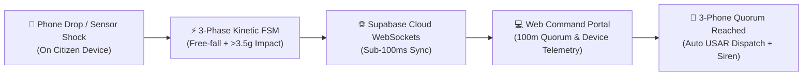

# 🌊 NeerNetra (नीर्नेत्र)
### Autonomous Civil Defense & Hyperlocal Disaster Response Ecosystem
**Live Production Web Portal:** [https://data-sih.vercel.app](https://data-sih.vercel.app) • **Mobile App:** [Direct Android APK Download](https://github.com/shivendra1911/Data_SIH/raw/main/mobile/apk/NeerNetra.apk)

---

## ⚡ Welcome Judges & Mentors!

NeerNetra is designed as a **unified two-part ecosystem** solving disaster management when cellular towers, electrical grids, and internet links collapse. 

To test our project immediately, here are the two core platforms:

| Platform | Direct Access / Download | What It Does | Source Code |
| :--- | :--- | :--- | :--- |
| 💻 **Web Command Center** | **[Launch Live Web Platform](https://data-sih.vercel.app)** *(No install needed)* | Tactical GIS Radar, Real-Time 100m Structural Collapse Clusters, 1/3rd Sector Landslide Consensus, and OSRM Road-Network Safe Route Navigation. | [`web/`](./web) |
| 📱 **Mobile Citizen App** | **[Download Android APK (NeerNetra.apk)](https://github.com/shivendra1911/Data_SIH/raw/main/mobile/apk/NeerNetra.apk)** | Autonomous on-device MEMS sensor fall detection, 60s inverted safety countdown, and offline Bluetooth/Wi-Fi Direct mesh (up to 32 hops without internet). | [`mobile/`](./mobile) |

> 📖 **Looking for a quick walkthrough?** Read our human-written judge test guide: **[`HOW_TO_USE.md`](./HOW_TO_USE.md)**.

---

## 💻 1. Web Platform (`web/`) — National Civil Defense Command Portal

* **Live Deployment:** **[https://data-sih.vercel.app](https://data-sih.vercel.app)** (Deployed on Vercel Edge)
* **Folder Location:** [`web/`](./web)

### Key Features:
* **Interactive Tactical GIS Radar:** Leaflet & Protomaps canvas rendering live citizen pings, danger contours, and relief shelters.
* **USAR Building Collapse Sentinel:** Aggregates incoming phone falls into real physical 100-meter clusters. Shows exact coordinates, live phone counts (`1 / 3 Phones Hit`), quorum progress bars, and itemized sensor readings (Peak $g$, free-fall $ms$).
* **Sub-Surface Landslide Consensus Monitor:** Real-time quorum ratio tracking ($\ge \frac{1}{3}\text{rd}$ active devices threshold) for early slope-shear detection in mountainous sectors (e.g., Wayanad & Joshimath).
* **Real OSRM Road Navigation:** Replaced straight Euclidean lines with real curved street-network navigation biased toward positive uphill elevation.
* **Sub-100ms Civil Defense Siren Broadcaster:** Direct Supabase PostgreSQL WebSocket channel bypassing deprecated Google Firebase FCM.

---

## 📱 2. Mobile App (`mobile/`) — Citizen Edge Sentinel

* **Download APK:** **[`mobile/apk/NeerNetra.apk`](https://github.com/shivendra1911/Data_SIH/raw/main/mobile/apk/NeerNetra.apk)** (Android 10+)
* **Folder Location:** [`mobile/`](./mobile)

### Key Features:
* **3-Phase Kinetic State Machine:** Runs on device accelerometer and gyroscope: Free Fall ($<0.2g$) $\rightarrow$ Hard Impact ($>3.5g$) $\rightarrow$ Debris Stillness ($<0.05\text{ rad/s}$).
* **Inverted 60-Second Dead-Man Countdown:** Audible check requiring a conscious citizen to tap *"I AM SAFE"*; if uncancelled, autonomously transmits distress coordinates.
* **Sub-Surface Bedrock Tremor Filter:** Listens for $10\text{–}50\text{ Hz}$ micro-vibrations characteristic of slope shear failure.
* **24/7 Android Foreground Service:** Holds an Android `PARTIAL_WAKE_LOCK` ensuring life-safety monitoring never gets killed during deep sleep or Doze mode.
* **Zero-Internet P2P Mesh:** Custom BLE GATT server and Wi-Fi Direct socket plumbing allowing phone-to-phone relay across up to 32 hops with zero cellular reception.
* **Wi-Fi Direct Walkie-Talkie:** Full-duplex push-to-talk voice intercom between trapped survivors and nearby rescuers.

---

## 🔄 How the Closed Loop Works (Phone $\rightarrow$ Web in Real Time)



1. A citizen's phone drops or simulates impact in the mobile app.
2. The phone evaluates the shock locally and pushes telemetry to the central API.
3. Within 2 seconds, the live web portal at `https://data-sih.vercel.app` displays the exact phone ID, coordinates, and peak impact.
4. When 3 nearby phones report within 100 meters, the cluster turns **CRITICAL COLLAPSE**, enabling 1-click rescue dispatch.

---

## 📂 Repository Directory Structure

```
├── web/                             # Next.js 14 Web Command Portal (Vercel Production)
│   ├── src/app/                     # Serverless API routes & UI pages
│   └── src/components/              # GIS Map, Collapse & Landslide consoles
│
├── mobile/                          # React Native (Expo) & Android Native Java App
│   ├── apk/                         # Direct downloadable Android APK (NeerNetra.apk)
│   ├── android/                     # Low-level Native Java BLE GATT & Wi-Fi Direct Mesh
│   └── src/services/                # Kinetic FSMs & Sensor Detectors
│
├── backend/                         # FastAPI Python Server & Hydrology ML
│   ├── main.py                      # REST endpoints & Haversine clustering
│   └── neernetra_model.pkl          # Random Forest GLOF & Flash Flood model
│
├── docs/                            # Internal architecture documentation & slide decks
│   └── archive/                     # Historical logs, test suites & legacy sheets
│
├── HOW_TO_USE.md                    # Step-by-Step Judge & Mentor Testing Guide
├── NeerNetra_Finale_Build_Plan.doc  # Official Step Zero Deliverable (Word Document)
└── README.md                        # Master Entry Point
```

---

## 👨‍💻 Testing Guide for Evaluators
For complete step-by-step instructions on running a live test between the phone app and the web portal, see:  
👉 **[`HOW_TO_USE.md`](./HOW_TO_USE.md)**
